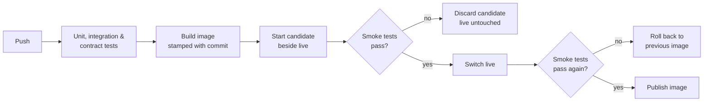

# Release Guard

A small clinic **Bookings API** used to show how I test, ship and watch a service:

| Area | What's here |
|---|---|
| **API & integration testing** | Jest + Supertest suite (28 tests, ~96% line coverage): happy paths, validation, conflicts, error formats. Every response is checked against the **OpenAPI contract** (`openapi.json`). |
| **Release validation** | `scripts/deploy.sh` starts the new image beside the live one, runs Playwright API smoke tests (health, readiness, running commit, a real booking, latency budget), and only then switches. A failed release never goes live; a failure after the switch rolls back. |
| **Observability** | Prometheus metrics (request rate, errors and latency by route, bookings), alert rules **with unit tests** (`promtool test rules`), a provisioned Grafana dashboard, and a scheduled synthetic check. |

## How a release flows



CI also runs a **rollback drill** on every push: it deploys a release with every API call failing (`CHAOS_ERROR_RATE=1`) and fails the build if that release is accepted.

## Run it

```bash
npm install
npm start                       # API on http://localhost:3000
npm test                        # integration + contract tests with coverage
BASE_URL=http://localhost:3000 npm run test:smoke   # post-deploy smoke tests
```

With Docker, the full monitoring stack:

```bash
docker compose up --build
npm run load                    # steady traffic for the dashboard
```

- API: http://localhost:3000
- Prometheus (and the alert rules under Alerts): http://localhost:9090
- Grafana dashboard: http://localhost:3030

Rehearse an incident: `CHAOS_ERROR_RATE=0.2 docker compose up -d api` makes 20% of API calls fail. The error-rate panel turns red and `HighErrorRate` fires after two minutes. `CHAOS_LATENCY_MS=800` does the same for `SlowResponses`.

## API

| Method | Path | |
|---|---|---|
| GET | `/health`, `/ready`, `/version`, `/metrics` | operational endpoints |
| GET | `/api/doctors`, `/api/slots` | reference data |
| GET | `/api/appointments?doctorId=&date=` | list |
| POST | `/api/appointments` | book (409 if the slot is taken) |
| GET / PATCH | `/api/appointments/:id` | read / cancel |

Full contract: [openapi.json](openapi.json).

## Layout

```
src/                  Express API, SQLite (node:sqlite), Prometheus metrics, fault injection
tests/integration/    Jest + Supertest
tests/smoke/          Playwright API tests, run after deploy and on a schedule
tests/contract.js     OpenAPI response checker shared by both suites
scripts/deploy.sh     validated deploy with rollback
ops/prometheus/       scrape config, alert rules, alert rule unit tests
ops/grafana/          datasource, dashboard provisioning
.github/workflows/    CI pipeline and synthetic check
```

## Notes

- Data is kept in memory to keep the demo self-contained, so each deploy starts empty. A real deployment would set `DB_PATH` to a mounted volume or use a managed database.
- The synthetic check runs every 30 minutes once the repository variable `PUBLIC_BASE_URL` points at a deployed instance.
